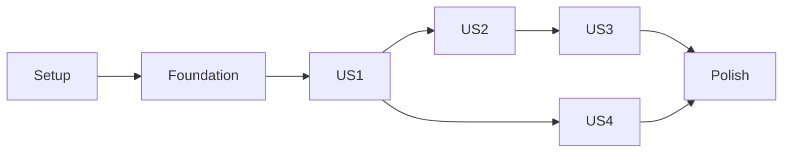

# Tasks: Behavior MCP — Agent-Native Declarative Systems

**Input**: Design documents in `specs/001-agent-native-systems/`.

**Prerequisites**: [plan.md](plan.md), [spec.md](spec.md), [research.md](research.md),
[data-model.md](data-model.md), [contracts](contracts/mcp.md), [quickstart.md](quickstart.md),
and the [constitution](../../.specify/memory/constitution.md).

**Tests**: Mandatory under the specification and Constitution XIV. Every behavior implementation
must follow an observed failing test. Implementation status is tracked below; phase and red/green evidence is retained in `evidence/`.

**Organization**: Seven phases and four stories in specified priority order. Existing canonical
artifacts and semantic authority remain upstream. All paths below are repository-relative.

## Format: Task ID, Parallel Marker, Story and Description

- Task lines contain a checkbox, sequential T-number, optional `[P]`, story label in story phases,
  concrete action and exact file paths.
- `[P]` applies only after all listed prerequisites are complete and only to distinct output
  files. It does not authorize concurrent edits to a shared module.
- Explicit task dependencies and phase barriers both apply.

## Path Conventions

- Application: `src/behavior_mcp/`; deterministic tests: `tests/`.
- Toolchain: `pyproject.toml`, `uv.lock`, `flake.nix`, `flake.lock`, `scripts/check`.
- Reviewed schemas: `specs/001-agent-native-systems/contracts/`, bundled as package resources.
- Implementation evidence: `specs/001-agent-native-systems/evidence/`.

## Execution and Evidence Rules

1. Test-writing tasks include running the new assertions and observing an expected missing-behavior
   failure before related production implementation. Save command, assertion and sanitized red
   result in `evidence/tdd/<TaskID>.json` under this feature directory. Separate files prevent
   parallel evidence writers from sharing an append target.
2. Implementation records green results for the same assertions. Environment-only failures are
   not behavioral red evidence. Never weaken assertions, copy expectations from MCP or break
   working code to manufacture red. Reuse earlier red/green evidence when behavior already works.
3. Public fixtures use the pinned authoritative interfaces and cover positive, negative and
   unsupported cases. Every suite runs without a live AI or note application.
4. Follow reviewed schemas exactly, including required/optional fields, numeric/collection bounds
   and `additionalProperties: false`. Quoted entity constraints below are preserved from the data model.
5. A missing public capability leaves dependent work visibly incomplete and gets exact release,
   interface, attempt, impact and reproducible evidence in `SEMANTIC_GAPS.md`. Continue independent
   work; no private imports, handwritten Wire IR or local semantic fallback.
6. Focused story checks support parallel development. The final locked command
   `nix develop --command ./scripts/check` with every applicable suite is required for CI and
   completion; intermediate focused success does not authorize release.

## Phase 1: Setup (Shared Infrastructure)

**Purpose**: Create the declared toolchain, package and one reproducible quality command.

- [X] T001 Create `flake.nix` and portable `flake.lock` pinned to Nixpkgs `293d6abedf0478e681a4dfcfcb35b30fc796a32f`, providing Python 3.13, uv and native Ruff 0.15.14; do not commit this machine's registry/store path.
- [X] T002 Create `pyproject.toml`, `uv.lock` and `src/behavior_mcp/__init__.py`; pin the released Behavior 0.14.0 wheel/hash, bundled Core identity, MCP/mcp-types 2.3.0, jsonschema 4.26.0 and planned build/test/type tools; declare both planned entry points, package data and Python >=3.13 without implementing features. (depends on T001)
- [X] T003 Write and observe failing release/public-boundary tests in `tests/unit/test_dependencies.py`: correct release passes, wrong binding/Core/verifier, substituted wheel/import origin, private imports and checkout overrides fail; use declared identities from plan.md rather than trusting installed version text alone. (depends on T002)
- [X] T004 Implement shared startup/gate identity checks in `src/behavior_mcp/dependencies.py` against the released wheel SHA256, `behavior.versions()`, Core commit and supported public imports; make the dependency tests pass without importing private bindings or rebuilding Behavior. (depends on T003)
- [X] T005 Implement executable `scripts/check` and tool settings in `pyproject.toml`: locked sync, release/public-boundary verification, native Ruff format/lint, strict mypy and all applicable pytest suites; expose the single command `nix develop --command ./scripts/check` with no success-through-skip or dependency fallback. (depends on T004)
- [X] T006 [P] Configure `.github/workflows/ci.yml` to invoke exactly `nix develop --command ./scripts/check` with committed Nix/Python locks and the declared Linux target; preserve failure evidence and do not introduce a different CI dependency graph. (depends on T005)
- [X] T007 [P] Add `.gitignore` entries for virtual environments, tool caches, temporary SQLite workspaces and local trusted credentials/configuration; retain tracked Spec Kit skills/design artifacts and avoid ignoring required reproducibility evidence. (depends on T005)
- [X] T008 [P] Create deterministic test infrastructure in `tests/conftest.py`: isolated workspace paths, injected clock/context, subprocess lifecycle helpers and per-task red/green evidence capture; no live AI, note application or implicit real-clock expectation may be required. (depends on T005)

**Checkpoint**: Declared package/toolchain and the quality command are ready for foundational tests.

---

## Phase 2: Foundational (Blocking Prerequisites)

**Purpose**: Establish shared syntax, trusted context, host storage and transport boundaries before story implementation.

**Barrier**: Complete all Setup tasks before this phase and all Foundation tasks before story implementation.

- [X] T009 [P] Write and observe failing tests in `tests/unit/test_trusted_context.py` and `tests/contract/test_host_policy_schema.py` for closed policy/approval schemas: exact or explicit workspace selector, AND matching, deny-by-default, unknown keys/values, creation scope and independently authenticated issuer binding; reject mismatched issuer claims. Caller metadata never grants authority. (depends on T006, T007, T008)
- [X] T010 [P] Write and observe failing tests in `tests/contract/test_schema_envelopes.py` for all five reviewed schemas and synthetic result fixtures: reject empty verified/activated evidence, verified-from-inconclusive and contradictory errors; verify exact proposal revision inputs, installed schema resources and runtime subject/report/receipt consistency. (depends on T006, T007, T008)
- [X] T011 [P] Write and observe failing host-storage tests in `tests/integration/test_host_storage.py` for verified DELETE/EXTRA/foreign-key settings, durable directory creation, immutable artifact/policy rows, transaction rollback, one workspace owner and local policy/system locks shared by trusted processes. (depends on T006, T007, T008)
- [X] T012 [P] Write and observe failing tests in `tests/contract/test_stdio_boundary.py` for pre-decode 1 MiB frame bounds, depth 32, JSON-RPC failures, protocol-only stdout, modern 2026-07-28/legacy 2025-11-25 clients and untrusted protocol metadata; use public SDK streams. (depends on T006, T007, T008)
- [X] T013 [P] Write and observe failing tests in `tests/unit/test_diagnostics.py` for redacted errors/audit and distinct invalid-input, model, semantic, authorization, conflict, unsupported and infrastructure outcomes; public CommitRefused carrying BACKEND_ERROR must retain uncertainty rather than become a semantic denial. (depends on T006, T007, T008)
- [X] T014 Implement immutable trusted context and closed policy/approval parsing in `src/behavior_mcp/policy.py` using reviewed schemas and host-policy.md matching rules; exact selectors/operation grants combine with every applicable bound, missing/unknown rules deny, and issuer identity comes from independent administration. (depends on T009)
- [X] T015 Implement reviewed schema/resource loading and discriminated stage envelopes in `src/behavior_mcp/schemas.py`, bundling all five schemas and examples through `pyproject.toml`; preserve bounds/required fields, reject remote references and keep report validation and Behavior semantics authoritative. (depends on T010, T014)
- [X] T016 Implement SQLite connection/transaction and local lock utilities in `src/behavior_mcp/storage.py`: verified `journal_mode=DELETE`, `synchronous=EXTRA`, foreign keys, bounded busy waits and directory synchronization. Provide consistent policy-before-system lock ordering across server/admin processes; these are local host controls, not distributed semantics. (depends on T011)
- [X] T017 Initialize workspace host tables in `src/behavior_mcp/artifacts.py` for immutable blobs, policy versions and creation reservations using storage.py; enforce "Artifacts are durably stored before publishing any system reference" and label physical digests as byte digests, never semantic hashes. (depends on T016, T015)
- [X] T018 Implement the minimal launcher/lifespan and bounded stdio transport in `src/behavior_mcp/server.py` with public MCP Server/stream interfaces, trusted context and workspace ownership. Register only completed handlers; no selected-system session state, custom protocol compatibility layer or fake authority from stdio metadata. (depends on T012, T014, T015, T017)
- [X] T019 Implement shared exception-to-envelope and redacted diagnostics in `src/behavior_mcp/schemas.py` and `src/behavior_mcp/server.py`; keep protocol errors separate from known-tool results and proof outcome separate from completed request processing. (depends on T013, T018)
- [X] T020 [P] Create independently authored public-API fixture builders in `tests/fixtures/public_models.py` and frozen release metadata in `tests/fixtures/releases.json`; include admitted RequestFlow/StateMachine modules, original context/receipts, explicit Actor seed and equal-genesis separate-store fixtures without copying expected results from MCP code. (depends on T006, T007, T008)
- [X] T021 Run `scripts/check` over completed foundations and record actual results in `specs/001-agent-native-systems/evidence/foundation.json`; verify installed-package resources and public fixtures work outside source checkout before any story is declared ready. (depends on T014, T015, T016, T017, T018, T019, T020)

**Checkpoint**: Trusted context, syntax, storage, transport and public fixtures are ready before story implementation.

---

## Phase 3: User Story 1 - Discover and Propose a Declarative System (Priority: P1)

**Purpose**: Deliver the durable authoring checkpoint.

**Goal**: Discover supported model subsets, save/inspect proposals, lower/admit through public APIs and report exact verification outcomes without activation.

**Independent Test**: Using deterministic SDK clients, store and recover a RequestFlow proposal/manifest across restart; validate valid, malformed and unsupported definitions; distinguish all evidence stages and prove save/admission/verification never activates a system.

### Tests First

- [X] T022 [P] [US1] Write and observe failing tests in `tests/contract/test_authoring_tools.py` for all six authoring/discovery/gap tools, including new/fork/edit inputs, explicit base/expected revision, parent authorization, stale edit conflict, latest-at-read and exact-revision validation; verify structured results and zero activation side effects. (depends on T021)
- [X] T023 [P] [US1] Write and observe failing adapter tests in `tests/unit/test_request_flow_adapter.py` for required string fields, enum states, explicit initializer literals/input/trusted-actor references and fixed input-to-field assignment; reject arbitrary guards, expressions, code, emits and unsupported types without locally reproducing model semantics. (depends on T021)
- [X] T024 [P] [US1] Write and observe failing tests in `tests/integration/test_definition_artifacts.py` for stable ProposalId with immutable revisions, optional parent DefinitionId inheritance/fork rules, stale-head CAS conflicts, metadata separation and exact manifest source revision; recover source/context/receipts without treating receipt loading as approval. (depends on T021)
- [X] T025 [P] [US1] Write and observe failing verification tests in `tests/unit/test_verification.py` using public attestations and controlled worker failures; preserve subject/releases/profile/checks/obligations/assumptions and the constraint "`verified`, `inconclusive`, `unsupported`, timeout and infrastructure failure stay distinct". (depends on T021)
- [X] T026 [P] [US1] Write and observe failing authoring acceptance tests in `tests/acceptance/test_authoring.py` for discovery through durable proposal recovery without generated application code, a live AI or a note client; use both SDK client modes and assert the system remains inactive. (depends on T021)

### Implementation and Integration

- [X] T027 [US1] Implement the bounded RequestFlow adapter in `src/behavior_mcp/authoring.py` using only public entity/field/Enum/RequestFlow/BehaviorModule/set_ construction. Retain every declaration, fixed Actor/context input, composition input and adapter/release identity; use fixed trusted callbacks, never eval, generated source or handwritten Wire IR. (depends on T023)
- [X] T028 [US1] Implement new/fork/edit persistence in `src/behavior_mcp/artifacts.py`: new ProposalId/revision 1, explicit base_proposal_id + expected_proposal_revision CAS, immutable snapshots and inherited authorized optional parent DefinitionId. A changed parent requires a new fork; preserve separately stored display metadata and reject stale edits without appending. (depends on T024, T027)
- [X] T029 [US1] Implement immutable manifests in `src/behavior_mcp/artifacts.py` with exact source ProposalId/revision, parent metadata, canonical documents, hashes, generated module, receipts, diagnostics and release/context identities; receipt loading is not validation and host lineage never alters Behavior semantic identity. (depends on T028)
- [X] T030 [US1] Implement staged authoritative lowering/admission in `src/behavior_mcp/authoring.py` for the exact requested proposal_id/proposal_revision; a newer head cannot replace its source. Persist precise admitted output and refuse unresolved references/unsupported subsets without guessing. (depends on T027, T029)
- [X] T031 [US1] Implement public verify/Profile integration and bounded worker/deadline handling in `src/behavior_mcp/verification.py`, storing exact evidence through artifacts.py; preserve partial coverage and missing-solver/timeout outcomes and never treat admission or query completion as proof or approval. (depends on T025, T029)
- [X] T032 [US1] Implement pinned model/adapter discovery in `src/behavior_mcp/authoring.py`: separate upstream family availability from actual implemented authoring coverage, label host-owned schemas and source provenance, expose GAP-001..004 accurately and advertise StateMachine authoring as unavailable until its adapter is implemented. (depends on T030)
- [X] T033 [US1] Implement authoring/validation/verification builders in `src/behavior_mcp/schemas.py` against the completed discriminated contract: exact source/semantic subject, real public report identity/coverage/assumptions, verified only from actual verified evidence, and no fabricated attestation when no report exists. (depends on T022, T029, T031)
- [X] T034 [US1] Wire the six authoring/discovery/gap handlers into `src/behavior_mcp/server.py`, applying explicit artifact grants, reviewed schemas and precise failure encoding; no proposal, admission, receipt or verification result may change an active pointer. (depends on T032, T033, T031)
- [X] T035 [US1] Run focused US1 contract/unit/restart/acceptance checks and record actual evidence in `specs/001-agent-native-systems/evidence/us1.json`; confirm unsupported canonical-only reconstruction remains visible and no runtime/deployment completion is claimed by this checkpoint. (depends on T034, T026)

**Checkpoint**: Durable authoring is independently testable and remains inactive.

---

## Phase 4: User Story 2 - Activate, Use and Recover a Persistent System (Priority: P1)

**Purpose**: Deliver the first usable persistent runtime increment.

**Goal**: Create two isolated systems, activate unattended within host delegation, execute Core decisions and recover durable outcomes without duplicate transitions.

**Independent Test**: Use pre-admitted public fixtures for runtime tests; run creation, allowed/refused actions, wrong-system access, two client sessions, independent activation, normal restart, process interruption and original-bundle recovery. Require all 45 public backend conformance cases plus physical recovery evidence.

### Tests First

- [X] T036 [P] [US2] Write and observe failing public-backend conformance tests in `tests/conformance/test_sqlite_backend.py` with fresh SQLite targets and behavior.run_conformance; require all 45 pinned cases, ten required callbacks, optional-callback fallback, complete creation recovery, as-of reads and applied/head_moved publication results. (depends on T035)
- [X] T037 [P] [US2] Write and observe failing physical storage tests in `tests/integration/test_backend_crashes.py` covering kill/reopen before and after creation/commit publication, consistent historical reads, writer conflict and zero partial documents; these tests must use real files/processes, not only logical in-memory fault injection. (depends on T035)
- [X] T038 [P] [US2] Write and observe failing tests in `tests/unit/test_delegated_activation.py` for every host-policy.md rule: exact allowlists/status edges/effect fields, creation/capacity, required check/obligation/assumption matching and non-waivable boundaries; exact approval waives only named candidate bounds. (depends on T035)
- [X] T039 [P] [US2] Write and observe failing lifecycle tests in `tests/integration/test_system_creation.py` for stable SystemId, optional display label, durable creation reservations and inactive publication; enforce "SystemId never enters a Core genesis document merely to force a different hash" and creation retry never resets later history. (depends on T035)
- [X] T040 [P] [US2] Write and observe failing public-runtime comparison tests in `tests/integration/test_runtime_decisions.py` for generated capability schemas, trusted Actor and explicit fixed time, read/evaluate without commit, ALLOW/INVALID_INPUT/DENY, full resulting-state validity and no speculative external I/O. (depends on T035)
- [X] T041 [P] [US2] Write and observe failing tests in `tests/integration/test_uncertain_commit.py` and `tests/integration/test_uncertain_activation.py`: Core original-bundle recovery versus atomic activation receipts, crashes before/after publication, old-revision retry, later activation, changed policy, wrong-system/request reuse and zero second activation/audit append. (depends on T035)
- [X] T042 [P] [US2] Write and observe failing contract tests in `tests/contract/test_system_tools.py` for systems_create/list, system_inspect, definition_activate, capabilities_list, state_read, transition_evaluate/commit, operation_get and system_recover; include wrong SystemId/token/approval, inactive systems and every protected operation's denied access. (depends on T035)
- [X] T043 [P] [US2] Write and observe failing tests in `tests/integration/test_admin_policy.py` for validated immutable policies/approvals, independent trusted issuer/grantee binding, explicit structural Core profile, exact subject/policy/history/exception scope and non-waivable checks; retain referenced versions and expose no MCP administration tool. (depends on T035)
- [X] T044 [P] [US2] Write and observe failing isolation/race tests in `tests/integration/test_system_isolation.py` using two systems with identical immutable artifacts/genesis: simultaneous use, independent activation, equal Core StoreIds, cross-system denial, competing activation, intervening state writes and trusted subprocess policy updates under shared local locks. (depends on T035)
- [X] T045 [P] [US2] Write and observe failing tests in `tests/integration/test_server_recovery.py` and `tests/acceptance/test_persistent_runtime.py` for one workspace owner, the full two-system runtime journey, both SDK modes, cancellation before/after durable commit, incomplete creation, missing artifacts and restart; cancellation cannot prove rollback and recovery must not reset another system. (depends on T035)

### Implementation and Integration

- [X] T046 [US2] Implement genesis/head/create and historical document/index callbacks in `src/behavior_mcp/sqlite_backend.py` through the public Python Backend contract; atomically initialize all seed documents, preserve equivalent creation recovery and keep Core-provided documents/identities unchanged. Do not create domain ORM update paths. (depends on T036, T037)
- [X] T047 [US2] Implement public backend commit compare-and-set in `src/behavior_mcp/sqlite_backend.py`; publish supplied versions/removals/references/record/head and a scoped host operation receipt in one transaction. Enforce "A head conflict writes no success receipt" and return exactly applied/head_moved without recomputing Core hashes or adding fields to Core records. (depends on T046, T041)
- [X] T048 [US2] Complete verified durability/consistent-read/failure handling in `src/behavior_mcp/sqlite_backend.py` and `src/behavior_mcp/storage.py` until public conformance and actual crash tests pass; distinguish busy/I/O/uncertain failures from Core semantic conflicts and preserve immutable historical reads. (depends on T047)
- [X] T049 [US2] Implement system descriptors, durable reservations and public Core creation in `src/behavior_mcp/systems.py`; preserve "optional display label", "Creation leaves the system inactive" and "Lifecycle: `creating` → `inactive` → `active`; uncertain publication enters `recovery_required`". Use only explicitly trusted bootstrap seed and keep each SystemId's Store/active reference separate. (depends on T039, T048)
- [X] T050 [US2] Implement the closed candidate matcher in `src/behavior_mcp/policy.py` using fresh trusted public reconstruction and exact schema-defined sets/booleans/status edges; enforce applicable bounds with AND, validate authoritative proof evidence, deny unknown coverage and apply only named exact-version exceptions. (depends on T038, T049)
- [X] T051 [US2] Implement trusted `behavior-mcp-admin` in `src/behavior_mcp/admin.py` and validated policy/approval persistence in `src/behavior_mcp/artifacts.py`; authenticate the administrative issuer independently and reject mismatched document claims, share policy-before-system locks and preserve immutable versions. Approval cannot waive scope/operation grants, Core checks, schema/effect refusals or self-authority restrictions. (depends on T043, T050)
- [X] T052 [US2] Implement activation/retry in `src/behavior_mcp/systems.py`: resolve identical scoped OperationId/request receipts before fresh CAS; otherwise require unchanged SchemaHash and recheck current policy/history plus public export_seed_at under all writers. Atomically publish pointer, audit and request-bound original result; distinguish original receipt from observed current deployment and never use a Core bundle for activation. (depends on T041, T044, T050, T051)
- [X] T053 [US2] Implement generated capability inspection and state reads in `src/behavior_mcp/systems.py` through public module export, Store.load and checked snapshot/read interfaces; obtain names/parameter roles from authoritative output, apply page defaults 50/max 100 and enforce "Runtime requests fail until separate authorized activation". (depends on T040, T052)
- [X] T054 [US2] Implement evaluation records/tokens in `src/behavior_mcp/operations.py`: capture trusted workspace/SystemId/principal, exact request/active/policy context and explicit time; persist the unchanged public Core bundle before commit and return a token only for an allowed bundle. Token possession conveys no permission. (depends on T041, T053)
- [X] T055 [US2] Implement transition commitment in `src/behavior_mcp/operations.py` with live scope/deployment checks, original evaluated bundle and Core compare-and-set; enforce operation states `evaluated`, `committing`, `committed`, `not_committed`, `refused`, `unknown`, and "Reusing an OperationId with different scope or request is an input conflict, never implicit replacement". (depends on T054, T047)
- [X] T056 [US2] Implement kind-specific recovery in `src/behavior_mcp/operations.py`: transitions use Core receipts/original bundles, activation its atomic host receipt, creation its reserved target/Core result. Changed scope/request reuse conflicts; unknown publication blocks only that system, disclosure requires current read authority and fresh publication requires current grants. (depends on T045, T055)
- [X] T057 [US2] Implement startup/system recovery in `src/behavior_mcp/systems.py` and `src/behavior_mcp/server.py` by operation kind; restore original activation or Core outcomes without rewriting authorization, replaying a fresh activation, resetting another Store or substituting newer artifacts. (depends on T049, T056)
- [X] T058 [US2] Implement runtime builders in `src/behavior_mcp/schemas.py` from the completed result schema: require activation operation/request/subject/policy/history/evidence, original receipt plus observed deployment, and correct transition already status. Check repeated identities against authoritative stored outcomes and retain typed failures/uncertainty. (depends on T042, T057)
- [X] T059 [US2] Wire all ten system/runtime/recovery handlers in `src/behavior_mcp/server.py`; authorize every workspace/SystemId/operation, filter listings and shared-artifact metadata, preserve protocol versus operation errors, and accept neither caller context/approvals nor arbitrary database/filesystem/process access. (depends on T058, T053, T052)
- [X] T060 [US2] Run the prewritten persistent acceptance suite in `tests/acceptance/test_persistent_runtime.py` against the wired server using both SDK modes, two systems and two independent sessions; resolve every demonstrated gap through its failing assertion before code changes and verify normal restart, abrupt recovery and allowed/refused operations. (depends on T059, T045, T044)
- [X] T061 [US2] Run focused US2 suites and record backend 45-case results separately from physical crash/authorization/isolation/retry evidence in `specs/001-agent-native-systems/evidence/us2.json`; only declare the runtime increment complete when both public conformance and physical tests pass. (depends on T060, T048)

**Checkpoint**: Two isolated systems can be explicitly activated, used and recovered under delegated authority.

---

## Phase 5: User Story 3 - Inspect and Revise a System Safely (Priority: P2)

**Purpose**: Preserve system identity and historical meaning through a supported revision.

**Goal**: Retrieve source after restart, reconstruct unchanged, propose a semantic change, activate under current authority and replay historical behavior.

**Independent Test**: Use persisted public fixtures; reconstruct twice under exact versions/context, rename a transition with unchanged SchemaHash/SystemId, activate only one of two systems, replay original history and refuse schema changes or stale deployment conditions.

### Tests First

- [X] T062 [P] [US3] Write and observe failing tests in `tests/integration/test_authoring_roundtrip.py` for two exact-revision reconstruction cycles across restart, explicit parent/base lineage and frozen validation under concurrent edits; preserve complete context/receipts/releases and reject canonical-only guessing. (depends on T061)
- [X] T063 [P] [US3] Write and observe failing tests in `tests/integration/test_definition_revision.py` and `tests/acceptance/test_revision.py` for post-restart semantic revision: ModelHash/BehaviorHash change, SchemaHash/SystemId remain stable, inactive proposals do not replace deployment, and one system's activation preserves the other and all original history. (depends on T061)
- [X] T064 [P] [US3] Write and observe failing historical replay tests in `tests/integration/test_historical_replay.py` with exact original modules, receipts, releases and policy evidence; missing/mismatched artifacts fail closed, and newer verifier/policy labels never overwrite historical claims. (depends on T061)
- [X] T065 [P] [US3] Write and observe failing tests in `tests/integration/test_evolution_boundaries.py` for schema-changing revisions, unsupported governed migration, invalid current state, intervening writers and stale approvals; assert unchanged active/state pointers and no best-effort conversion or direct state edits. (depends on T061)

### Implementation and Integration

- [X] T066 [US3] Complete revision/retrieval in `src/behavior_mcp/artifacts.py` using explicit base/expected revision and optional authorized parent DefinitionId: immutable snapshots, latest-at-read versus exact lookup, exact validation source and stable SystemId. Reuse correct existing paths. (depends on T062, T063)
- [X] T067 [US3] Implement fresh authoritative reconstruction/identity comparison in `src/behavior_mcp/authoring.py` for stored proposal/context and exact adapter/dependency/composition identities; reject missing bodies or mismatches, preserving relevant ModelHash/BehaviorHash/SchemaHash without local canonicalization. (depends on T066)
- [X] T068 [US3] Complete revision deployment checks in `src/behavior_mcp/systems.py` using the fresh rebuilt candidate, current policy, SchemaHash equality and exact live export_seed_at validation under writer coordination; schema changes stay explicitly unsupported even with a trusted approval. (depends on T067, T065)
- [X] T069 [US3] Implement historical artifact resolution and public replay integration in `src/behavior_mcp/artifacts.py` and `src/behavior_mcp/systems.py` using replay_data/replay_behavior; retain old module/receipt/migration references where applicable and never reinterpret old evidence under the current verifier. (depends on T064, T068)
- [X] T070 [US3] Complete revision/recovery projections in `src/behavior_mcp/server.py` and `src/behavior_mcp/schemas.py` with exact proposal revisions, parent/source references and activation-specific receipt outcomes through the revised existing tools; no implicit lineage, activation or migration. (depends on T069)
- [X] T071 [US3] Run the prewritten full revision suite in `tests/acceptance/test_revision.py` for unchanged reconstruction, semantic revision and historical replay using two systems and real persistent storage; preserve red evidence before fixing each uncovered case and reuse already-correct behavior rather than adding duplicate paths. (depends on T070)
- [X] T072 [US3] Record focused round-trip, revision, schema-refusal, race and historical replay results in `specs/001-agent-native-systems/evidence/us3.json`; relate current source, admitted identities, old/new activation records and preserved historical evidence without claiming formal proof from examples. (depends on T071)

**Checkpoint**: Supported revisions preserve SystemId/history; schema changes refuse explicitly.

---

## Phase 6: User Story 4 - Compose Models and Understand Capability Limits (Priority: P2)

**Purpose**: Establish bounded generalization and exact limitations.

**Goal**: Compose RequestFlow and StateMachine through public contracts and report conflicts, missing source/configuration metadata and unsupported capabilities honestly.

**Independent Test**: Use authoritative examples from two families plus a conflicting/unsupported case; require public lowering/receipt evidence, unchanged first ModelHash with context-dependent whole BehaviorHash and reproducible findings for all seven research questions.

### Tests First

- [X] T073 [P] [US4] Write and observe failing tests in `tests/integration/test_model_composition.py` and `tests/acceptance/test_composition.py` for RequestFlow plus StateMachine, complete declaration/context retention, two receipts, ownership/reference conflicts and ModelHash versus whole BehaviorHash dependence; shared atomic models must remain in one module/system. (depends on T035)
- [X] T074 [P] [US4] Write and observe failing tests in `tests/contract/test_model_coverage.py` for StateMachine adapter enablement, host-schema provenance, precise authoring limits and no promise of generic upstream schemas or authored Approval/WorkQueue; generated capability names/roles must come from admitted output. (depends on T035)
- [X] T075 [P] [US4] Write and observe failing composed-provenance tests in `tests/integration/test_composed_provenance.py`: restore both original definitions/context/receipts after Wire import and restart, reject canonical-only/unsupported expression substitutions, and preserve explicit gap evidence instead of guessing missing content. (depends on T035)

### Implementation and Integration

- [X] T076 [US4] Implement the bounded StateMachine adapter in `src/behavior_mcp/authoring.py` through public entity/field/Enum/StateMachine APIs, with explicit subject/state field/subject parameter/entry states and supported typed transfers; reject arbitrary guards, extra state bindings, effects or commands outside the profile. (depends on T073)
- [X] T077 [US4] Implement multi-model construction in `src/behavior_mcp/authoring.py` and manifest persistence in `src/behavior_mcp/artifacts.py`, retaining full composition membership/context and authoritative receipts; allow supported new-system compositions, while existing-system schema changes still refuse activation. (depends on T076, T075)
- [X] T078 [US4] Enable the implemented second subset in `src/behavior_mcp/authoring.py` with exact adapter/release identities and provenance; preserve conditional unsupported statuses and inspect generated declarations without local naming/semantic rules or a plugin framework. (depends on T074, T077)
- [X] T079 [US4] Update models_list, gaps_list and authoring projections in `src/behavior_mcp/server.py` to expose actual composition coverage and precise refusals while preserving the existing fixed tools/schemas and trusted workspace artifact permissions. (depends on T078)
- [X] T080 [US4] Run the prewritten composed positive/conflict/unsupported journey in `tests/acceptance/test_composition.py` against completed handlers; fix missing behavior only after its assertion fails, keep public Models authoritative and prove no cross-system orchestration or local semantic fallback is introduced. (depends on T079)
- [X] T081 [US4] Update `SEMANTIC_GAPS.md` and `specs/001-agent-native-systems/research.md` with actual attempted interfaces/evidence and all seven RQ dispositions; canonical-only and generic-schema gaps remain visible, Wire provenance remains external, and ordinary migration availability must not be confused with the governed Python migration gap. (depends on T080)
- [X] T082 [US4] Record composition/provenance/unsupported coverage and upstream outcomes in `specs/001-agent-native-systems/evidence/us4.json`; leave dependent delivery criteria unmet for any actual blocking gap instead of substituting a local semantic fallback. (depends on T081)

**Checkpoint**: Two model families compose authoritatively and their limits remain visible.

---

## Phase 7: Polish & Cross-Cutting Concerns

**Purpose**: Package, document and validate the complete supported experiment.

- [X] T083 Build source/wheel distributions from `pyproject.toml` and run existing package/resource/entry-point checks from a clean installed environment outside the checkout; record lock/release identities and results in `specs/001-agent-native-systems/evidence/package.json` and fix only demonstrated failures through failing tests. (depends on T061, T072, T082)
- [X] T084 [P] Write `README.md` and `docs/operations.md` for trusted launcher/admin setup, delegated unattended activation, local OS assumptions, input bounds, independent system recovery, original-operation retry and the one quality command; keep examples generic and distinguish projections from authoritative state. (depends on T061, T072, T082)
- [X] T085 [P] Write `docs/compatibility.md` documenting exact supported releases/protocol modes, retained authoring representation, schema/effect/model limits, artifact preservation, conditional migration gap and evidence required for dependency updates; link `SEMANTIC_GAPS.md` without declaring unresolved capabilities implemented. (depends on T061, T072, T082)
- [X] T086 Configure `.github/workflows/release-checks.yml` to run the same locked `nix develop --command ./scripts/check` as CI, including packaged-artifact/public-API/conformance/recovery checks; retain evidence and do not turn this task into publishing or deployment. (depends on T083)
- [X] T087 Audit the installed graph and application imports using `src/behavior_mcp/dependencies.py` and `scripts/check`; reject private Core/binding imports, checkout overrides, rebuilt release substitutions and missing original artifact identities; record the audit in `specs/001-agent-native-systems/evidence/dependency-boundary.json`. (depends on T083, T086)
- [X] T088 Execute every supported scenario in `specs/001-agent-native-systems/quickstart.md` against the installed package, including two systems, both protocol modes, a real restart/crash and a subsequent revision; record actual results in `specs/001-agent-native-systems/evidence/quickstart.json` and preserve unsupported outcomes honestly. (depends on T083, T084, T085)
- [X] T089 Review all seven Constitution Check questions against the actual implementation and evidence in `specs/001-agent-native-systems/plan.md`; record the review in `specs/001-agent-native-systems/evidence/constitution-check.json` and keep blocking gaps/untested guarantees visible instead of weakening the constitution. (depends on T087, T088)
- [X] T090 Run `nix develop --command ./scripts/check` with the official graph and record all SC-001..SC-011/FR-001..FR-016 outcomes, public conformance and physical recovery evidence in `specs/001-agent-native-systems/evidence/release-acceptance.json`; any applicable failure blocks completion, and empirical success never becomes an unsupported proof claim. (depends on T089, T086)

**Checkpoint**: The full declared gate and evidence support only the actual delivered scope.

---

## Dependencies & Execution Order

### Phase Dependencies

| Phase | Required completion |
| --- | --- |
| Setup | Start with T001. |
| Foundation | All Setup tasks; foundation checkpoint T021. |
| US1 | T021. |
| US2 | T035 supplies the admitted-artifact/adapter seam. |
| US3 | T061 plus existing US1 artifacts. |
| US4 | T035; independent tests/authoring can overlap US2 runtime work. |
| Polish | T061, T072, T082. |

### User Story Dependencies

US1 is an independently useful authoring checkpoint. US2 uses the admitted-artifact seam, while
runtime tests use pre-admitted public fixtures independently of an agent authoring journey.
US3 requires durable authoring/runtime; US4 can prove composition after US1 using public fixtures.
Independent testability does not require duplicating shared infrastructure or concealing these
integration dependencies.

### Within Each User Story

Tests and observed failures come before related behavior, followed by data/service implementation,
validated outputs, handler wiring and the prewritten acceptance journey. An integration step
cannot retroactively introduce untested behavior. Preserve source/artifact/authority/state
identities throughout.

### Parallel Opportunities

After T005, Setup tasks T006, T007, T008 write distinct files. After Setup,
Foundation tests T009, T010, T011, T012, T013 and public-fixture task T020
can proceed independently. After story completion, documentation tasks T084, T085 can run together.

US2 backend/operation work and US4 authoring work may overlap. Serialize changes to `server.py`,
`artifacts.py`, `policy.py` and shared schemas; no production implementation task is marked
parallel solely because it belongs to another story.

## Parallel Example: User Story 1

After T021, run T022, T023, T024, T025, T026 using isolated workspaces.
Each owns distinct test/evidence files; complete the relevant red assertion before its dependent
implementation. The implementation tasks remain serialized wherever they share files.

## Parallel Example: User Story 2

After T035, run T036, T037, T038, T039, T040, T041, T042, T043, T044, T045 using isolated workspaces.
Each owns distinct test/evidence files; complete the relevant red assertion before its dependent
implementation. The implementation tasks remain serialized wherever they share files.

## Parallel Example: User Story 3

After T061, run T062, T063, T064, T065 using isolated workspaces.
Each owns distinct test/evidence files; complete the relevant red assertion before its dependent
implementation. The implementation tasks remain serialized wherever they share files.

## Parallel Example: User Story 4

After T035, run T073, T074, T075 using isolated workspaces.
Each owns distinct test/evidence files; complete the relevant red assertion before its dependent
implementation. The implementation tasks remain serialized wherever they share files.

## Coverage and Acceptance Traceability

### Functional Requirements

| Requirement | Primary tasks |
| --- | --- |
| FR-001 | T032, T034, T078 |
| FR-002 | T023, T027, T030, T076 |
| FR-003 | T029, T062, T067, T075 |
| FR-004 | T073, T077, T080 |
| FR-005 | T025, T030, T031, T033 |
| FR-006 | T024, T029, T049, T069 |
| FR-007 | T036, T047, T048, T055 |
| FR-008 | T050, T051, T052, T068 |
| FR-009 | T053, T054, T055, T059 |
| FR-010 | T014, T038, T043, T050, T059 |
| FR-011 | T018, T026, T060, T088 |
| FR-012 | T015, T019, T031, T058, T069 |
| FR-013 | T041, T047, T056, T057 |
| FR-014 | T032, T081, T082, T085 |
| FR-015 | T020, T040, T062, T067 |
| FR-016 | T023, T040, T050, T080 |

### Measurable Outcomes

| Outcome | Evidence-producing tasks |
| --- | --- |
| SC-001 | T035, T060, T071, T088 |
| SC-002 | T023, T040, T073 |
| SC-003 | T037, T044, T045, T061 |
| SC-004 | T062, T067, T072 |
| SC-005 | T063, T068, T071 |
| SC-006 | T026, T038, T043, T042, T052 |
| SC-007 | T037, T041, T044, T065 |
| SC-008 | T025, T031, T058 |
| SC-009 | T073, T080, T082 |
| SC-010 | T081, T082, T089 |
| SC-011 | T026, T060, T071, T088 |

### Interface and Entity Coverage

All six authoring/discovery/gap tools are tested in T022 and wired in T034.
All ten system/runtime/recovery tools are tested in T042 and wired in T059.
T079 updates real composition coverage without adding another tool language.

| Entity or boundary | Tasks |
| --- | --- |
| Proposal/context and Definition Manifest | T028, T029, T066, T067 |
| SystemId, independent Store and immutable sharing | T039, T046, T049, T044 |
| Host policy and exact-version approval | T014, T050, T051 |
| Activation record and active pointer | T052, T068 |
| Evaluation, operation receipt and recovery | T054, T055, T056 |
| Validation/verification evidence | T030, T031, T033 |
| Historical artifacts and replay | T064, T069 |

## Implementation Strategy

### MVP First

1. Complete Setup and Foundation before story implementation.
2. Deliver US1 as a durable authoring/inspection checkpoint with no runtime authority.
3. Deliver US2 for the first usable persistent runtime MVP, including two-system isolation and
   uncertain-outcome recovery. US1 alone is not the complete persistent-system demonstration.
4. Complete US3 and US4 before claiming the specification's full experiment: post-restart revision,
   historical replay, composition findings and every required acceptance outcome.
5. Complete Polish and the full gate; any applicable failed or blocked criterion stays visible.

### Incremental Delivery

Review concrete evidence at each checkpoint. Preserve immutable artifacts, advertise actual
restrictions and add only demonstrated public capabilities. A composition introducing schema may
be valid for a new system while its activation into an existing system remains unsupported.
Ordinary upstream migration support does not authorize a local semantic fallback.

### Parallel Team Strategy

Use only independent file batches and isolated test workspaces. US2 runtime and US4 authoring
share an admitted-artifact contract, with one owner at a time for integration edits. Every
participant uses the same declared release graph; local overrides are not official conformance.

## Notes

- The original plan contains 90 tasks: Setup 8, Foundation 13, US1 14, US2 26, US3 11,
  US4 10 and Polish 8. There are 33 parallel-marked tasks under explicit prerequisites.
- The retained authoring representation is justified by canonical omissions and never becomes
  an independent source of model semantics or a promise of arbitrary reconstruction.
- Keep admission/proof, authorization/content, evaluation/commitment, backend conformance/physical
  durability and external intents/completed external work distinct.
- The final command and actual evidence govern completion; generating this list implements none
  of its pending tasks and authorizes no publishing or deployment.

## Phase 8: Convergence

**Assessment**: 2026-10-27. Reassessed all 90 existing tasks against the current code,
16 functional requirements, 11 success criteria, 37 acceptance scenarios, 22 plan decisions
and 16 constitution principles. Existing task text and completion marks are preserved.
Six findings remain: two CRITICAL, three HIGH and one MEDIUM; four partial and two contradicting.
Read-only, in-memory probes reproduced the verification-subject mismatch, incorrect recovery
statuses, unrecoverable pre-database reservation and interrupted system listing. These are host
implementation gaps, not evidence of missing upstream Behavior semantics.

**Execution**: Follow the existing observed-red-before-green evidence rules. Process the critical
findings first. Changes to shared modules and reviewed schemas are sequential. Completion requires
the full locked quality command and updated affected acceptance/Constitution Check evidence;
the previously passing gate does not establish acceptance of the cases identified below.

- [X] T091 CRITICAL — Bind verification to the exact retained definition, restoring Constitution V's requirement that verification claims retain their exact subject. Write and observe failing tests in `tests/unit/test_verification.py`, `tests/contract/test_schema_envelopes.py` and `tests/contract/test_authoring_tools.py` for mismatched retained source/module/hash/context and a raw public report whose behavior identity differs from the envelope subject. Then change `src/behavior_mcp/server.py` to resolve the candidate through the authoritative reconstruction/identity checks in `src/behavior_mcp/authoring.py` before verification, and change `src/behavior_mcp/schemas.py` to reject contradictory subject/report/evidence identities rather than relying on JSON shape. Preserve the genuine upstream result and report identity. Evidence: `server.py:363-392` builds the stored proposal directly; `schemas.py:109-130` never compares `report.behavior_version`; an in-memory probe using the real pinned verifier returned `verification_verified` with declared BehaviorHash `sha256:c9f182aac46cd9ef9c7b00d584c696e28de3be417ce33b8bb241d96f5a66f8aa` and actual report subject `sha256:587179a6b90823a4587b90cb81a231a40847980d9896b8ac31ebd6ed0bb2f1ac`. Sources: FR-005, FR-012, SC-008, US1/AC3, Constitution V, T010, T033, T067 (contradicts).
- [X] T092 CRITICAL — Make recovery outcome reporting truthful for each operation kind, restoring Constitution IX's requirement to distinguish transport/infrastructure failures and actual operation outcomes. Write and observe failing tests in `tests/unit/test_diagnostics.py` and `tests/integration/test_server_recovery.py` for an activation published during recovery followed by an infrastructure failure before acknowledgment, and for Core creation published before its separate host receipt. Then update `src/behavior_mcp/schemas.py`, `src/behavior_mcp/operations.py` and the relevant recovery paths in `src/behavior_mcp/systems.py` to carry publication uncertainty through recovery and establish creation outcomes from the original Core creation evidence; absence of a host receipt alone must not imply `not_committed`. Keep `operation_get` read-only, require current grants before any potentially fresh publication, and preserve original authorization and receipts. Evidence: `schemas.py:233-238` excludes recovery from unexpected-publication uncertainty; `operations.py:291` defaults every receiptless kind to `not_committed`; probes reproduced `operation_may_have_committed=false` after a recovery activation publication and `not_committed` with an existing public Core genesis/history. Sources: FR-012, FR-013, US2/AC7, Constitution IX, T019, T049, T056, T058 (contradicts).
- [X] T093 HIGH — Close the durable-reservation-before-database crash window. Write and observe a failing real-process interruption test in `tests/integration/test_server_recovery.py` immediately after the host creation reservation is committed and before backend initialization, plus interruption during backend schema initialization. Then update `src/behavior_mcp/artifacts.py`, `src/behavior_mcp/systems.py` and storage initialization as needed so a published reservation always has a recoverable durable initialization state, for example by durably preparing the empty backend before publishing its reservation. Reuse the reserved SystemId and original request, enforce current authority before fresh Core creation, and retain fail-closed behavior for genuinely missing initialized storage; file absence alone must never authorize recreating history. Evidence: `systems.py:380-393` publishes the reservation before opening SQLite, while `systems.py:362-367` and `systems.py:264-270` reject both retry and recovery when that file does not yet exist. Sources: FR-013, US2/AC6-7, plan: durable creation and recovery, T039, T045, T049, T056 (partial). Depends on T092.
- [X] T094 HIGH — Isolate system discovery from another system's incomplete creation or storage failure. Write and observe failing contract/integration tests in `tests/contract/test_system_tools.py` and `tests/integration/test_server_recovery.py` with one healthy system and another authorized system whose descriptor is incomplete or whose original storage is unavailable. Then update `src/behavior_mcp/systems.py` and `specs/001-agent-native-systems/contracts/result.schema.json` as needed so `systems_list` returns the healthy descriptors and an accurate `creating` or `recovery_required` projection for the affected system, without claiming an unestablished active state, leaking unauthorized metadata or repairing storage during a read. Preserve filtering, pagination and current system-specific authorization. Evidence: `systems.py:227-235` lets one `inspect` exception abort the complete listing; `systems.py:313-316` raises `SYSTEM_CREATING` rather than projecting the planned lifecycle. Sources: FR-009, FR-013, US2/AC6, plan: independent recovery, T049, T057, T059 (partial). Depends on T093.
- [X] T095 HIGH — Expose the definition-linked artifact contents promised by authorized inspection. Write and observe failing MCP contract/acceptance tests in `tests/contract/test_authoring_tools.py` and `tests/acceptance/test_authoring.py` that retrieve the original source/context, canonical documents, generated Wire module, complete lowering receipts and retained definition-specific validation/verification evidence after restart without Python-side ArtifactStore access. Then extend the existing `definition_get` projections in `src/behavior_mcp/server.py`, `src/behavior_mcp/artifacts.py`, `src/behavior_mcp/schemas.py` and the reviewed contracts under `specs/001-agent-native-systems/contracts/` to provide separately identified artifacts with checked references and original release/subject/profile labels. Do not introduce unrestricted blob/filesystem access or disclose other systems' deployment/authorization metadata through shared definitions. Evidence: `server.py:361-362` returns only the manifest; `authoring.py:195-217` stores module/context/receipt references, and none of the sixteen MCP tools resolves those references or retrieves an old verification report. Sources: FR-005, FR-006, FR-012, US1/AC6, US3/AC1, contracts/mcp.md: definition_get and Result Boundaries, T024, T029, T034, T064 (partial). Depends on T091.
- [X] T096 MEDIUM — Implement the trusted operational-limit configuration promised by the plan. Write and observe failing launcher/transport/verification/read tests for valid overrides, unchanged defaults, malformed or excessive limits and agent attempts to set host limits. Then add a closed, validated trusted configuration in `src/behavior_mcp/server.py` and thread it through framing/depth limits, read pagination in `src/behavior_mcp/systems.py`, and verification capacity/budgets in `src/behavior_mcp/verification.py`; permit operator restrictions within the reviewed public schema maxima, retain one coordinated writer per system, and record the actual verification profile parameters. Update `docs/operations.md` and applicable contract documentation with the supported configuration. Evidence: `server.py:14-15` fixes frame/depth constants and `server.py:411-415` rejects additional host configuration; `systems.py:817` fixes the page default; `verification.py:15-19` fixes profiles and worker capacity. Sources: plan: Technical Context / Constraints and Scale/Scope, T018, T031, T053, T084 (partial). After all six remediation tasks, run `nix develop --command ./scripts/check` and refresh the affected evidence including `specs/001-agent-native-systems/evidence/release-acceptance.json` and `specs/001-agent-native-systems/evidence/constitution-check.json`; keep any unmet acceptance criterion visible.

**Completion (2026-10-27)**: T091–T096 are complete with recorded behavioral red/green evidence.
The locked quality gate passes 197 tests, the clean installed wheel passes 196 tests, and all
45 public Core backend conformance cases pass. Source-distribution reconstruction reproduces
the wheel bytes. See `evidence/release-acceptance.json` and `evidence/constitution-check.json`;
the four previously documented upstream limitations remain explicit.
