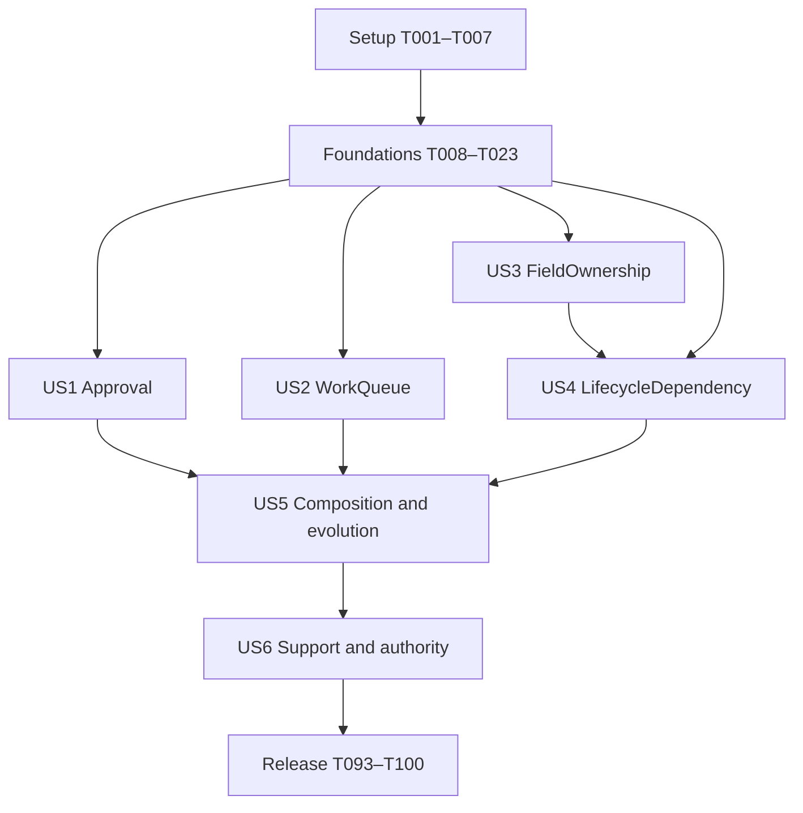

# Tasks: Remaining Behavior Models

**Input**: [spec.md](spec.md), [plan.md](plan.md), [research.md](research.md),
[data-model.md](data-model.md), [contracts/](contracts/) and [quickstart.md](quickstart.md).

**Feature directory**: `specs/002-remaining-behavior-models`

**Tests**: Mandatory under constitution XIV and FR-022. Every behavior change starts with an
observed failing deterministic test, then public-boundary implementation, then a recorded green run.
No live AI model, private Behavior API, client executable code or direct domain-state edit is allowed.

**Organization**: Setup → shared foundations → six independently testable stories → release checks.
All 100 tasks are required for the complete feature. The Approval MVP is a useful validation
checkpoint, not permission to label all remaining models delivered or abandon later tasks.

## Format and execution rules

- Every task is `- [ ] Tnnn [P?] [USn?] description with exact paths`.
- Paths are repository-relative; resolve them against `/home/kalle/repos/behavior-mcp`.
- `[P]` marks distinct-file tasks runnable together only after their shared prerequisites complete.
  It does not authorize parallel edits to shared production modules or bypass the red-first gate.
- For each test task, record actual red and later green commands/output under
  `specs/002-remaining-behavior-models/evidence/tdd/Tnnn.json`. After T003, use
  `scripts/record-test --feature-dir specs/002-remaining-behavior-models Tnnn red|green <command>`.
  Record T002's initial run explicitly before the recorder supports its new option.
- A red run must demonstrate the intended missing behavior, not only test collection/setup failure
  or unavailable infrastructure. Existing fixture/baseline checks may pass; do not manufacture red.
- Do not change `src/behavior_mcp/authoring.py`, the frozen v1 authoring schema or any published
  v2 handler/helper/schema bytes. Follow [immutable versions](contracts/adapter-versions.md): each
  checkpoint publishes a new exact version and retains actual earlier workspaces. No latest alias,
  mutable handler dependency, runtime source loading or context rewriting is allowed.
- Never derive new model semantics, counts, lease rules or proof validity in host code. Compare
  public outputs against independent reference builders/expectations, including unsupported cases.
- A discovered upstream boundary is recorded in `SEMANTIC_GAPS.md` and acceptance evidence; it
  cannot be satisfied by a fallback or by checking the task complete.
- Setup/foundation/final tasks have no story label. All six story phases carry their `[USn]` label.

## Phase 1: Setup (Shared Infrastructure)

**Goal**: Preserve the actual pre-feature baseline, isolate evidence and provision the exact declared proof tools.

**Independent Test**: Baseline fixtures load with the existing server; feature-002 evidence cannot overwrite feature-001 evidence; the locked proof package has the released identity.

- [X] T001 Capture an isolated pre-feature workspace through existing public MCP/Core operations in tests/fixtures/legacy_v1/ and tests/fixtures/legacy_v1/manifest.json; retain proposal, active definition, source/context, policy and nonempty history plus original authoring/schema byte hashes; never use user data or edit authoritative rows.
- [X] T002 Write and observe failing feature-scoped recorder tests in tests/unit/test_tdd_evidence_paths.py using isolated temporary working directories: explicit feature path, legacy default, repeated task IDs and preservation of both red/green histories; retain the actual initial red output in specs/002-remaining-behavior-models/evidence/tdd/T002.json.
- [X] T003 Add a backward-compatible --feature-dir option to scripts/record-test and make tests/unit/test_tdd_evidence_paths.py pass; preserve old invocation behavior while directing all new task evidence to specs/002-remaining-behavior-models/evidence/tdd/.
- [X] T004 [P] Author independent public reference builders and manually stated positive/negative/unsupported expectations in tests/fixtures/remaining_models.py for Approval, all nine queue operations, generated-action FieldOwnership and canonical Parent/Child; include controlled trusted time and Core-created Actor records without copying adapter output.
- [X] T005 [P] Write and observe failing exact-proof-toolchain readiness tests in tests/unit/test_proof_dependencies.py covering the declared Nix graph, expected Lean output/derivation, wrong version, missing tooling and forbidden binary overrides; normal runtime must remain usable without a certification requirement.
- [X] T006 Extend flake.nix and flake.lock with the public safety-proof-toolchain package at Behavior commit 1cba9e16ff73f927ae08e70a7bc74a6ca52355e4, set trusted toolchain output/derivation variables, and add readiness checks in src/behavior_mcp/dependencies.py and src/behavior_mcp/release.json using specs/002-remaining-behavior-models/evidence/proof_toolchain.json; preserve existing nixpkgs, Python, uv.lock and released wheel identities.
- [X] T007 Record actual setup checks, public probe outcomes, toolchain identity, unchanged legacy bytes and baseline test results in specs/002-remaining-behavior-models/evidence/implementation-baseline.json; establish that planning probes are feasibility evidence and not completed feature acceptance.

**Checkpoint**: Baseline fixtures load with the existing server; feature-002 evidence cannot overwrite feature-001 evidence; the locked proof package has the released identity.

---

## Phase 2: Foundational (Blocking Prerequisites)

**Goal**: Create versioned integration seams without changing legacy semantics or claiming unsupported new model support.

**Independent Test**: All foundation tests pass with actual public reference modules; old workspace invocation/recovery still works; unsupported profiles and malformed input fail closed.

### Tests — write and observe red before implementation

- [X] T008 [P] Write and observe failing installed-schema and closed-input tests in tests/contract/test_expanded_authoring.py for both formats, metadata and CAS revision rules; quote and enforce "Identifier length is at most 64", "request frame at most 1 MiB", "JSON depth at most 32", "at most 8 models, 8 policies, 16 entities, 16 lifecycle actions, 32 fields per entity and 4,096 total expression nodes" from specs/002-remaining-behavior-models/contracts/authoring.md.
- [X] T009 [P] Write and observe failing exact-version dispatch tests in tests/integration/test_expanded_compatibility.py and tests/integration/test_incremental_adapter_retention.py: retain v1 source/context, require explicit v2 adapter_version, reject latest/unknown versions, require packaged immutable handler/schema closures and never replace an old context; define the retained checkpoint fixture protocol before creating the first MVP fixture.
- [X] T010 [P] Write and observe failing public-reference comparisons in tests/unit/test_fragments_v2.py for every scalar/enum/Id/Ref/nominal descriptor, every expression op and all three lifecycle factories; include wrong types, dangling/cyclic authoring handles, unknown nodes, explicit guard roots, enum case order and no eval/exec or host semantic evaluation.
- [X] T011 [P] Write and observe failing policy/approval tests in tests/contract/test_host_policy_v2.py using the existing host-policy-v2.schema.json and activation-approval-v2.schema.json plus operator fixtures in specs/002-remaining-behavior-models/contracts/examples/; enforce unique grant keys, exact/subset/range matching, required whole guard/model-condition roots, null no-Safety identity, explicit evidence requirements and the documented non-waivable trust boundaries.
- [X] T012 [P] Write and observe failing versioned artifact/result tests in tests/integration/test_expanded_artifacts.py for complete source/context, "Uniqueness is DefinitionId, not BehaviorHash", separate operational/Safety artifacts, exact source release in evidence and unknown/mismatched context rejection.
- [X] T013 [P] Write and observe failing external-worker boundary tests in tests/unit/test_worker_limits.py for independent stdout/stderr overflow, deadlines, cancellation, process-group kill/reap, slot release, controlled CPU/address-space/file exhaustion and no partial successful result; retain existing verification-worker guarantees.
- [X] T014 [P] Write and observe failing trusted-context tests in tests/unit/test_semantic_time.py for "utc-unix-milliseconds.v1", "a nonnegative safe JSON integer" (0–9007199254740991, excluding Boolean), one trusted semantic/audit snapshot, missing/wrong-type provider, trusted Actor mapping and preservation of old TrustedContext calls.
- [X] T015 [P] Write and observe failing generic public-read/service tests in tests/integration/test_core_reads.py using trusted reference Store/modules: exact Store.read_intent response/record, publication-disabled backend, full StateRef/HistoryRef, OperationId binding, "pending/completed/refused/failed", original pending context/state on retry and complete-result size refusal rather than slicing.

### Implementation and acceptance

- [X] T016 Package the existing closed contracts in specs/002-remaining-behavior-models/contracts/ through pyproject.toml: all exact-version authoring validators, host-policy-v2.schema.json, activation-approval-v2.schema.json, expanded-result.schema.json and tool-additions.schema.json; extend src/behavior_mcp/schemas.py with trusted route/profile selection, local-only refs and no permissive legacy fallback for an invalid expanded result.
- [X] T017 Implement draft typed declarations, symbolic expressions and fixed lifecycle factories in src/behavior_mcp/authoring_v2.py and src/behavior_mcp/fragments_v2.py for disposable tests; prepare immutable versioned copies for publication, preserving explicit roots/order and public Behavior authority. No supported retained handler may import these mutable draft/facade modules.
- [X] T018 Implement code-owned exact (profile, adapter_version) dispatch in src/behavior_mcp/adapters.py and src/behavior_mcp/artifacts.py using contracts/adapter-versions.md; retain every published adapter_versions/v2_0_0.py, v2_1_0.py, v2_2_0.py and v2_3_0.py with its complete immutable helper/schema closure, reject draft/unavailable versions for supported activation, and preserve frozen v1 bytes and historical contexts without fallback.
- [X] T019 Implement the complete normative matcher from specs/002-remaining-behavior-models/contracts/host-policy.md in src/behavior_mcp/policy.py and src/behavior_mcp/admin.py: exact version selection, duplicate-key denial, declaration/fragment/whole-root bounds, selector subsets, threshold/attempt/time ranges, required policy/evidence checks and explicit exception mapping; preserve v1 rules and never infer semantic equivalence.
- [X] T020 Implement shared bounded fixed-command process execution in src/behavior_mcp/proof_worker.py and src/behavior_mcp/limits.py, reusing src/behavior_mcp/verification.py pipe collection; enforce 1 proof worker, 120-second proof/5-second read guards, 8 MiB stdout/1 MiB stderr, 8 MiB retained bundle and 1 MiB complete read output with tighten-only trusted ceilings and cleanup.
- [X] T021 Add trusted semantic/audit snapshot capture in src/behavior_mcp/policy.py and src/behavior_mcp/server.py, preserving the legacy clock interface; capture typed time explicitly only for new evaluations/time-dependent reads and never during model tracing or replay; expose no MCP control of provider, actor or worker.
- [X] T022 Implement generic scoped read journaling and public Store.read_intent/Store.replay_read in src/behavior_mcp/reads.py, route through src/behavior_mcp/server.py and src/behavior_mcp/systems.py, and use the bounded publication-disabled worker; persist pending subject/state/time before execution, retain exact responses and keep read failures outside the uncertain-domain-mutation gate.
- [X] T023 Deliver shared registry mechanics and strict expanded output/subject validation in src/behavior_mcp/server.py, src/behavior_mcp/systems.py, src/behavior_mcp/operations.py, src/behavior_mcp/verification.py and src/behavior_mcp/schemas.py; use retained release/version, install complete contracts before any slice emits new output and keep unfinished families unavailable. Record foundation/legacy green results in specs/002-remaining-behavior-models/evidence/foundation.json.

**Checkpoint**: All foundation tests pass with actual public reference modules; old workspace invocation/recovery still works; unsupported profiles and malformed input fail closed.

---

## Phase 3: User Story 1 — Author and Use an Approval System (Priority: P1, MVP)

**Goal**: Deliver one persistent explicitly activated Approval system with authoritative decisions and outcome reads.

**Independent Test**: Use only Approval plus required host foundations: discover, propose, admit, activate, create a subject, record trusted decisions, inspect all five derived outcomes, refuse duplicates and continue after restart without queues or Safety Models.

### Tests — write and observe red before implementation

- [X] T024 [P] [US1] Write and observe failing Approval admission, per-version catalog/registry/result and MVP acceptance tests in tests/contract/test_approval_authoring.py and tests/acceptance/test_remaining_models.py::test_approval using explicit adapter_version=2.0.0; include thresholds/payload/conditions, both decisions, status read schema and no implicit activation.
- [X] T025 [P] [US1] Write and observe failing runtime/reference tests in tests/integration/test_approval_runtime.py for approve/reject, pending/threshold boundaries, duplicate actor, closed/ineligible subject, invalid thresholds, unchanged subject and exact public counts/outcome/read replay; never compute expected results from the MCP adapter.
- [X] T026 [P] [US1] Write and observe failing Approval durability tests in tests/integration/test_approval_recovery.py for exact allowed/refused retries, lost acknowledgments, before/after-publication process death, shared Core transition identity, changed grants/Actor/activation and restart; use supported Core genesis/transitions for all actor fixtures.

### Implementation and acceptance

- [X] T027 [US1] Implement the draft Approval 2.0.0 handler in src/behavior_mcp/adapter_versions/v2_0_0.py with public subject/Actor, thresholds, payload, open/eligible fragments and approve/reject; integrate its exact-version catalog/routing/strict results in src/behavior_mcp/adapters.py and src/behavior_mcp/server.py before MVP acceptance, without advertising future checkpoints.
- [X] T028 [US1] Add Approval-specific candidate coverage to src/behavior_mcp/policy.py for thresholds, payload, decision conditions, generated creation fields and complete action/read inventory; keep runtime invocation grants distinct and reject actor/authority expansion.
- [X] T029 [US1] Retain Approval canonical document, ModelHash, receipt, diagnostics, exact source and module identity through src/behavior_mcp/adapters.py and src/behavior_mcp/artifacts.py; expose structured definition inspection without presenting admission as proof or host approval.
- [X] T030 [US1] Declare mcp_<model_id>_status in src/behavior_mcp/adapter_versions/v2_0_0.py using public read/project and all five derived handles; expose admitted metadata through src/behavior_mcp/systems.py and strict read results through src/behavior_mcp/reads.py and src/behavior_mcp/schemas.py now, without host counting or a dependency on US6.
- [X] T031 [US1] Bind the decision actor solely from trusted host context and retain exact allowed/refused actor evidence in src/behavior_mcp/operations.py; reject supplied actor overrides in every request role and preserve existing exact-request/token/commit distinctions.
- [X] T032 [US1] Validate and retain original Approval bundles/refusals across the complete crash/policy/deployment matrix in tests/integration/test_approval_recovery.py and src/behavior_mcp/operations.py; reconcile outcomes before any newly authorized publication and never infer noncommit only from a missing host receipt.
- [X] T033 [US1] Finalize and freeze src/behavior_mcp/adapter_versions/v2_0_0.py, its versioned helper closure and contracts/authoring-v2-2.0.0.schema.json before advertising supported 2.0.0; capture tests/fixtures/adapter_versions/v2_0_0/ through real public journeys, complete tests/acceptance/test_remaining_models.py::test_approval and record exact closure/semantic identities in specs/002-remaining-behavior-models/evidence/us1.json.
- [X] T034 [US1] Run standalone Approval discovery/admission/activation/read/retry/restart acceptance and tests/integration/test_incremental_adapter_retention.py against the captured 2.0.0 workspace, plus retained-v1 checks; record actual green results in specs/002-remaining-behavior-models/evidence/us1.json before declaring the persistent MVP supported.

**Checkpoint**: Use only Approval plus required host foundations: discover, propose, admit, activate, create a subject, record trusted decisions, inspect all five derived outcomes, refuse duplicates and continue after restart without queues or Safety Models.

---

## Phase 4: User Story 2 — Author and Use Persistent Work Queues (Priority: P1)

**Goal**: Deliver every queue capability and read with trusted current time, persistent ownership/generation and original-operation recovery.

**Independent Test**: Use a standalone queue with controlled trusted time; cover all nine operations and ready/expired/terminal reads, competing claims, restart and refusal/retry behavior without Approval or Safety Models.

### Tests — write and observe red before implementation

- [X] T035 [P] [US2] Write and observe failing queue 2.1.0 contract/catalog/result tests in tests/contract/test_work_queue_authoring.py and tests/acceptance/test_remaining_models.py::test_work_queue; extend tests/integration/test_incremental_adapter_retention.py to open the actual saved 2.0.0 workspace before/after queue addition; require all nine registrations, authorization, nominal time and payload.
- [X] T036 [P] [US2] Write and observe failing public-reference runtime tests in tests/integration/test_work_queue_runtime.py for enqueue, claim, renew, complete, retry, fail, recover, exhaust, cancel; include ready/expired/terminal reads, before/at/after lease boundaries, stale generations, exhausted attempts, terminal refusal and competing claims.
- [X] T037 [P] [US2] Write and observe failing host-time/identity/delegation tests in tests/integration/test_work_queue_context.py for forged now/worker/actor across input/bindings/context_proposals, only "lease_until" and "available_at" as proposed context, enqueue availability as input, per-capability offsets and retries after time advances.
- [X] T038 [P] [US2] Write and observe failing queue/read crash tests in tests/integration/test_work_queue_recovery.py covering every publication boundary, pending-read interruption after recorded state/time, shared Core identity, changed policy/worker/activation, current read authority and no duplicate enqueue/claim or uncertain-domain flag for read-only failure.

### Implementation and acceptance

- [X] T039 [US2] Add public WorkQueue support in the new src/behavior_mcp/adapter_versions/v2_1_0.py and immutable helper/schema closure, retaining 2.0.0 unchanged. Register all nine operations, ordered nominal time and explicit guards, and deliver queue catalog/routing/result variants in src/behavior_mcp/adapters.py and src/behavior_mcp/server.py before queue acceptance.
- [X] T040 [US2] Map actual admitted parameter roles in src/behavior_mcp/operations.py and src/behavior_mcp/reads.py: trusted now/worker/actor, proposed lease_until or retry/recovery available_at, ordinary enqueue availability; refuse unknown/unused or trusted override keys before Core evaluation.
- [X] T041 [US2] Enforce queue parameter, full generated operation/read inventory and temporal proposal bounds in src/behavior_mcp/policy.py; distinguish operational authorization from Core lease/generation/attempt decisions and preserve independent construction versus runtime grants.
- [X] T042 [US2] Expose public ready/expired and fixed terminal reads from src/behavior_mcp/adapter_versions/v2_1_0.py through src/behavior_mcp/systems.py and src/behavior_mcp/reads.py, with strict declared signatures/results in src/behavior_mcp/schemas.py; retain exact empty/complete lists and replay without modifying published 2.0.0.
- [X] T043 [US2] Persist trusted time/provider/worker provenance for allowed and refused queue evaluations and pending/completed reads in src/behavior_mcp/operations.py and src/behavior_mcp/reads.py; identical retries and replay reuse original time while fresh evaluations acquire a new trusted snapshot.
- [X] T044 [US2] Extend fresh-publication identity checks to every bound trusted actor/worker in src/behavior_mcp/operations.py while keeping historical reconciliation read-authorized and independent; use original bundles with recorded time, never replace them or compare historical now with the current clock as an identity check.
- [X] T045 [US2] Preserve queue-specific public diagnostics, generation evidence, typed context and exact read/state/history identities in src/behavior_mcp/schemas.py and src/behavior_mcp/systems.py; oversized complete results remain resource failures rather than truncated success or semantic denial.
- [X] T046 [US2] Run queue contention, stale-source, all crash boundaries and interrupted-read replay in tests/integration/test_work_queue_runtime.py and tests/integration/test_work_queue_recovery.py against the real SQLite/Core boundary; record no duplicate events, partial commits or leaked capacity in specs/002-remaining-behavior-models/evidence/us2.json.
- [X] T047 [US2] Finalize/freeze 2.1.0 and its helpers plus contracts/authoring-v2-2.1.0.schema.json; capture tests/fixtures/adapter_versions/v2_1_0/, complete standalone queue acceptance in tests/acceptance/test_remaining_models.py::test_work_queue and reopen the exact saved 2.0.0 fixture via tests/integration/test_incremental_adapter_retention.py; record us2.json under specs/002-remaining-behavior-models/evidence/.
- [X] T048 [US2] Run all queue, foundational and prior Approval/legacy regressions from tests/contract/, tests/integration/ and tests/acceptance/test_remaining_models.py; record actual green results and exact reference versions in specs/002-remaining-behavior-models/evidence/us2.json.

**Checkpoint**: Use a standalone queue with controlled trusted time; cover all nine operations and ready/expired/terminal reads, competing claims, restart and refusal/retry behavior without Approval or Safety Models.

---

## Phase 5: User Story 3 — Declare Structural Field and Lifecycle Permissions (Priority: P1)

**Goal**: Deliver complete public FieldOwnership analysis over authored and generated actions without conflating it with proof or host permissions.

**Independent Test**: Use an existing StateMachine and fixed lifecycle factories with FieldOwnership only; validate writer/creator/remover restrictions, overlapping policies, generated selectors and restart without certification or LifecycleDependency.

### Tests — write and observe red before implementation

- [X] T049 [P] [US3] Write and observe failing FieldOwnership 2.2.0 contract/artifact/catalog tests in tests/contract/test_field_ownership_authoring.py; extend tests/integration/test_incremental_adapter_retention.py for earlier 2.0.0/2.1.0 workspaces, explicit selectors/empty lists and separate policy identities without fabricated receipts.
- [X] T050 [P] [US3] Write and observe failing public-reference structural tests in tests/integration/test_field_ownership.py for allowed/forbidden writers, creators and removers, overlapping restrictions, false guards, same-value assignments, generated actions and unsupported selectors; include tests/acceptance/test_remaining_models.py::test_field_ownership.
- [X] T051 [P] [US3] Write and observe failing delegation/no-escalation tests in tests/unit/test_safety_delegation.py for exact protected entity/field/selector bounds, removed/weakened policies, unchanged BehaviorHash with different policy identity and agent claims that cannot grant activation or runtime permission.

### Implementation and acceptance

- [X] T052 [US3] Add FieldOwnership/GeneratedAction via public constructors in the new src/behavior_mcp/adapter_versions/v2_2_0.py and frozen helper/schema closure; retain earlier implementations byte-for-byte and preserve whole-module analysis authority and explicit empty/intersecting restrictions.
- [X] T053 [US3] Persist the full public analysis, complete inventory/issues, individual policy ModelHashes/documents and policy_set_hash separately from operational receipts in src/behavior_mcp/artifacts.py and src/behavior_mcp/adapters.py; keep "Uniqueness is DefinitionId, not BehaviorHash".
- [X] T054 [US3] Enforce complete FieldOwnership policy/selector candidate bounds and explicit policy weakening/removal permissions in src/behavior_mcp/policy.py; old policies and domain safety declarations cannot grant new host authority.
- [X] T055 [US3] Deliver FieldOwnership 2.2.0 catalog/registry and explicitly uncertified structural results in src/behavior_mcp/adapters.py, src/behavior_mcp/server.py and src/behavior_mcp/schemas.py before its acceptance; retain issues and exact policy/artifact identities without waiting for US6.
- [X] T056 [US3] Freeze 2.2.0 and contracts/authoring-v2-2.2.0.schema.json, capture tests/fixtures/adapter_versions/v2_2_0/ and run independent FieldOwnership lifecycle/restart acceptance plus all earlier fixtures in tests/integration/test_incremental_adapter_retention.py; retain public comparisons and closure identities in specs/002-remaining-behavior-models/evidence/us3.json.
- [X] T057 [US3] Run FieldOwnership, v1/v2 delegation, artifact and prior-story regressions in tests/contract/, tests/unit/ and tests/integration/; retain actual green results and uncertified-status evidence in specs/002-remaining-behavior-models/evidence/us3.json.

**Checkpoint**: Use an existing StateMachine and fixed lifecycle factories with FieldOwnership only; validate writer/creator/remover restrictions, overlapping policies, generated selectors and restart without certification or LifecycleDependency.

---

## Phase 6: User Story 4 — Declare and Check Lifecycle Dependencies (Priority: P2)

**Goal**: Deliver canonical parent/child authoring, exact conditional proof/checking and independently established deployment state validity.

**Independent Test**: Use the generic Parent/Child fixture with its own FieldOwnership policies; exercise guarded lifecycle actions, missing/unsupported patterns, real certification, fresh import checking and exact-anchor activation without queues or Approval.

### Tests — write and observe red before implementation

- [X] T058 [P] [US4] Write and observe failing LifecycleDependency 2.3.0 tests in tests/integration/test_lifecycle_dependency.py and tests/acceptance/test_remaining_models.py::test_lifecycle_dependency for Ref/guard/unsupported boundaries; extend tests/integration/test_incremental_adapter_retention.py to protect all earlier version fixtures before adding the new handler.
- [X] T059 [P] [US4] Write and observe failing real certification/import tests in tests/integration/test_safety_evidence.py: exact subject/complete policy set, valid conditional certificate, fresh loaded-bundle checking, changed/tampered proof, same BehaviorHash with wrong policies, missing/wrong tools, exclusions/assumptions and no trust in imported flags.
- [X] T060 [P] [US4] Write and observe failing deployment tests in tests/integration/test_safety_deployment.py for public Valid/Invalid/Unestablished state evidence, exact full HistoryRef/StateRef, detached snapshots, stale anchors, incoming-policy changes, genesis validity, every writer path and explicit trusted activation; certificates and prior observational reports cannot authorize activation alone.
- [X] T061 [P] [US4] Write and observe failing proof/resource/inspection tests in tests/integration/test_safety_workers.py for separate stdout/stderr overflow, deadline/cancellation/slot cleanup, restart with incomplete staging, partial artifacts, fixed toolchain/profile, 1–65,536-byte evidence chunks and denial of system-specific state/deployment evidence through shared definition access.

### Implementation and acceptance

- [X] T062 [US4] Add LifecycleDependency in the new src/behavior_mcp/adapter_versions/v2_3_0.py and immutable helper/schema closure through public constructors; preserve exact parent/child/ownership inputs and explicit traced roots, retain all earlier implementations and report unsupported public issues without local proof-pattern interpretation.
- [X] T063 [US4] Implement fixed safety-default certification/checking commands in src/behavior_mcp/proof_worker.py and orchestration in src/behavior_mcp/safety.py; reconstruct the exact original definition and complete Safety policies through adapters before public certify_safety, since Wire alone loses Safety provenance, and enforce the pinned tools and resource ceilings.
- [X] T064 [US4] Implement explicit unverified bundle retention followed by public load_safety_bundle/verify_safety_evidence in src/behavior_mcp/safety.py and src/behavior_mcp/artifacts.py; accept size-bounded JSON data only, link new checking evidence separately and never trust client certificate flags, code, paths or toolchain arguments.
- [X] T065 [US4] Implement exact assessment/certificate persistence, repeated subject/policy checks and strict evidence_chunk results in src/behavior_mcp/artifacts.py, src/behavior_mcp/server.py and src/behavior_mcp/schemas.py before US4 acceptance; enforce nonnegative offset, 1–65,536-byte chunks and no system-only evidence disclosure through shared definitions.
- [X] T066 [US4] Implement state_validate_safety through public validate_safety_snapshot on a scoped Core Store in src/behavior_mcp/safety.py and src/behavior_mcp/systems.py; retain "Valid/Invalid/Unestablished", all full-anchor/acquisition/validator fields and matches_anchor, with no detached JSON substitute or implicit activation.
- [X] T067 [US4] Integrate required proof/obligation/assumption checks and fresh incoming-state validation into src/behavior_mcp/policy.py and src/behavior_mcp/systems.py; keep proof work outside writer locks but acquire/recheck complete policy/definition/current history under policy-before-system coordination before atomic activation, including genesis and no-certificate-required lifecycle deployments.
- [X] T068 [US4] Bind v2 exact approval and activation receipts to DefinitionId, BehaviorHash, SchemaHash, complete policy_set_hash, evidence set, authorization and full history in src/behavior_mcp/admin.py, src/behavior_mcp/policy.py and src/behavior_mcp/systems.py; forbid exceptions that waive required proof/state/scope or use unchanged BehaviorHash as approval of a different policy set.
- [X] T069 [US4] Deliver LifecycleDependency and actual safety certification/checking/state-validation registry entries and complete strict result variants in src/behavior_mcp/adapters.py, src/behavior_mcp/server.py and src/behavior_mcp/schemas.py before US4 acceptance; retain public outcomes, exceptions/scope/initial validity and no certificate ref without a real certificate.
- [X] T070 [US4] Finalize/freeze 2.3.0 and contracts/authoring-v2-2.3.0.schema.json, capture tests/fixtures/adapter_versions/v2_3_0/ and complete Parent/Child/certification/state/activation acceptance in tests/acceptance/test_remaining_models.py::test_lifecycle_dependency; reopen all earlier checkpoint workspaces unchanged and record exact proof/version evidence in specs/002-remaining-behavior-models/evidence/us4.json.
- [X] T071 [US4] Implement bounded owned-staging cleanup for interrupted proof/checking jobs in src/behavior_mcp/safety.py and src/behavior_mcp/proof_worker.py; exercise host/worker restart through tests/integration/test_safety_workers.py, preserve authoritative artifacts and never promote an unfinished bundle to a certificate.
- [X] T072 [US4] Run the real pinned-toolchain proof/import, lifecycle/deployment/resource and prior-story regressions in tests/integration/ and tests/acceptance/test_remaining_models.py; record actual conditional outcomes, exact dependencies and green results in specs/002-remaining-behavior-models/evidence/us4.json without skips or stronger proof claims.

**Checkpoint**: Use the generic Parent/Child fixture with its own FieldOwnership policies; exercise guarded lifecycle actions, missing/unsupported patterns, real certification, fresh import checking and exact-anchor activation without queues or Approval.

---

## Phase 7: User Story 5 — Compose, Recover and Revise the Expanded Models (Priority: P2)

**Goal**: Preserve editable round-trips, immutable historical meaning, explicit revisions and compatible composition for all four added families and retained v1 systems.

**Independent Test**: Start from retained public definition fixtures, restart/rebuild/revise each family and both requested compositions, interpret old history and reject unsupported migration without depending on a live agent session.

### Tests — write and observe red before implementation

- [X] T073 [P] [US5] Write and observe failing remaining round-trip/revision tests in tests/integration/test_expanded_roundtrip.py and tests/integration/test_incremental_adapter_retention.py using actual v1/2.0.0/2.1.0/2.2.0/2.3.0 fixtures; cover exact immutable closure/schema identities, metadata/semantic changes, unknown-version refusal and explicit upgrades; add revision/composition acceptance.
- [X] T074 [P] [US5] Write and observe failing composition/evolution tests in tests/integration/test_expanded_composition.py for Approval plus RequestFlow, WorkQueue plus an independent existing model, generated-action safety policies, contributed handles/order, conflicting ownership/declarations, cyclic unsupported input and schema-changing activation refusal.
- [X] T075 [P] [US5] Extend retained-workspace failures in tests/integration/test_expanded_compatibility.py to include v1 source editing, same-profile revision, explicit v1-to-v2 proposal fork, invocation/commit/recovery, exact old schema/source bytes and old/new policy separation after expansion.
- [X] T076 [P] [US5] Write and observe failing historical behavior/read/evidence tests in tests/integration/test_expanded_history.py for policy-only edits retaining BehaviorHash, old activation segments, retained original proofs/toolchains, Core Wire replay independent of fresh authoring and no relabeling of old evidence under new policies.

### Implementation and acceptance

- [X] T077 [US5] Implement explicit revision/fork handling in src/behavior_mcp/adapters.py and src/behavior_mcp/artifacts.py with monotonic CAS ancestry and required exact adapter_version; preserve previously published handlers/schemas/workspaces, never silently upgrade a stored proposal, and reconstruct every supported checkpoint through its original package implementation.
- [X] T078 [US5] Complete composed declaration/handle assembly in the latest draft src/behavior_mcp/authoring_v2.py, then publish any necessary changes as a new immutable implementation/schema version with tests/integration/test_incremental_adapter_retention.py coverage; never edit an already frozen adapter_versions/v2_*.py or infer generated names/semantics.
- [X] T079 [US5] Resolve historical definition/read/Safety evidence by recorded DefinitionId, activation segment and full anchor in src/behavior_mcp/systems.py, src/behavior_mcp/reads.py and src/behavior_mcp/safety.py; retain public Core Wire replay and never select the newest policy/evidence solely by matching BehaviorHash.
- [X] T080 [US5] Preserve explicit schema-compatibility and migration refusal across expanded revision/activation paths in src/behavior_mcp/policy.py and src/behavior_mcp/systems.py; state/schema names or superficially matching fields cannot substitute for exact checks or trigger best-effort conversion.
- [X] T081 [US5] Run all four-family round-trip/revision, requested composition/conflict and legacy-context/history tests in tests/integration/test_expanded_roundtrip.py, tests/integration/test_expanded_composition.py, tests/integration/test_expanded_compatibility.py and tests/integration/test_expanded_history.py; record exact identity/evidence comparisons in specs/002-remaining-behavior-models/evidence/us5.json.
- [X] T082 [US5] Complete and run tests/acceptance/test_remaining_models.py::test_revision_and_composition using retained definition fixtures and restarted workspaces; confirm old active versions remain unchanged until authorized activation and record green acceptance in specs/002-remaining-behavior-models/evidence/us5.json.

**Checkpoint**: Start from retained public definition fixtures, restart/rebuild/revise each family and both requested compositions, interpret old history and reject unsupported migration without depending on a live agent session.

---

## Phase 8: User Story 6 — Understand Support and Authority Boundaries (Priority: P2)

**Goal**: Make all six families and their actual boundaries discoverable while enforcing trusted scope and honest errors across the expanded interface.

**Independent Test**: Inspect catalog/evidence fixtures and submit malformed, unsupported, forged and cross-system requests; verify independent simultaneous use/recovery with no live AI model.

### Tests — write and observe red before implementation

- [X] T083 [P] [US6] Write cross-family catalog/registry audit tests in tests/contract/test_expanded_catalog.py and tests/acceptance/test_remaining_models.py::test_support_and_authority; all per-slice interfaces already exist, so test exact supported-version matrices, configured readiness and unavailable future features without postponing earlier MVP functionality.
- [X] T084 [P] [US6] Write and observe failing authorization/isolation tests in tests/integration/test_expanded_isolation.py for workspace/SystemId/principal/operation/read/evidence scope, simultaneous independent systems, shared immutable blobs, equal hashes, separate activation/recovery and forged deployment approvals or trusted identity claims.
- [X] T085 [P] [US6] Write and observe failing error/evidence/privacy tests in tests/contract/test_expanded_results.py for parsing/model/refusal/authorization/conflict/unsupported/infrastructure distinctions, no success on missing/inconclusive proof, exact subject/release binding, private diagnostics redaction and false operation_may_have_committed on pure read failures.

### Implementation and acceptance

- [X] T086 [US6] Audit every already delivered slice result/stage/status and subject identity check in src/behavior_mcp/schemas.py against expanded-result.schema.json and tests/contract/test_expanded_results.py; this is not initial implementation of earlier slice validators. Reproduce any uncovered mismatch as red before its fix and preserve legacy variants.
- [X] T087 [US6] Audit six-family discovery and generic registry/descriptions in src/behavior_mcp/adapters.py and src/behavior_mcp/server.py against tests/contract/test_expanded_catalog.py; all earlier slices already deliver their own entries/handlers/results. Confirm exact immutable version/schema provenance and configured readiness; US6 audits already delivered interfaces.
- [X] T088 [US6] Apply current workspace/system/principal/operation/read authorization consistently in src/behavior_mcp/policy.py, src/behavior_mcp/server.py, src/behavior_mcp/reads.py and src/behavior_mcp/safety.py; keep receipt/read disclosure separate from fresh commit/activation authority and prevent domain approvals/policies from granting host powers.
- [X] T089 [US6] Enforce independent mutable state/history/active pointer/read journal/recovery scope for expanded systems in src/behavior_mcp/systems.py and src/behavior_mcp/operations.py; shared artifacts/equal hashes grant no cross-system access, and one system recovery cannot reset or reinterpret another.
- [X] T090 [US6] Expose supported limitations and remaining gap references in src/behavior_mcp/adapters.py and SEMANTIC_GAPS.md, retaining exact release/evidence/category/impact/status for every actual new limitation; never treat additional adapters as closure of GAP-001–004 or substitute host rules for unsupported semantics.
- [X] T091 [US6] Run malformed/adversarial, time/identity spoof, shared-artifact evidence access, stdout/stderr/resource and privacy cases from tests/contract/test_expanded_results.py and tests/integration/test_expanded_isolation.py; record structured outcomes and zero unintended mutations/activations in specs/002-remaining-behavior-models/evidence/us6.json.
- [X] T092 [US6] Complete and run tests/acceptance/test_remaining_models.py::test_support_and_authority with two independently activated/recovered systems and all six accurate catalog entries; record current authority checks, truthful evidence statuses and green results in specs/002-remaining-behavior-models/evidence/us6.json.

**Checkpoint**: Inspect catalog/evidence fixtures and submit malformed, unsupported, forged and cross-system requests; verify independent simultaneous use/recovery with no live AI model.

---

## Phase 9: Polish & Cross-Cutting Concerns

**Goal**: Establish complete installed/reproducible acceptance and honest release documentation after all mandatory stories pass.

**Independent Test**: The one documented quality gate passes against source and clean installed distributions, and every FR/SC maps to evidence without hiding blocking gaps.

- [X] T093 [P] Update README.md, docs/operations.md and docs/compatibility.md with the actual delivered family/profile matrix, trusted time/delegation, exact proof prerequisites, read/output/resource limits, recovery and retained-context behavior; keep all examples domain-neutral and all proof/scope/unsupported claims exact.
- [X] T094 [P] Run the existing released dependency/public-import checks and all 45 public Backend conformance cases in tests/unit/test_dependencies.py and tests/conformance/test_sqlite_backend.py; record exact graph, boundary and conformance results in specs/002-remaining-behavior-models/evidence/dependency-conformance.json, including publication-disabled reconciliation regression coverage.
- [X] T095 Extend clean wheel/source rebuild checks in tests/integration/test_package_installation.py and pyproject.toml to include every retained immutable adapter/helper/schema version and saved checkpoint fixture; run exact old/new version journeys outside the checkout, compare rebuilt wheels and retain the 900-second installed-suite budget.
- [X] T096 Update scripts/check, .github/workflows/ci.yml and .github/workflows/release-checks.yml to use the same reproducible gate, include new contract/probe format/lint/type checks, require exact proof readiness and positive certification without skips, and upload both feature evidence directories plus dist/.
- [X] T097 Validate specs/002-remaining-behavior-models/quickstart.md using actual stdio MCP and trusted administration with the existing bounded operator/approval/result fixtures in specs/002-remaining-behavior-models/contracts/examples/; add only required nonsecret launcher examples and real CLI acceptance, never invent policy grammar during implementation.
- [X] T098 Review all seven Constitution Check questions against final code, trusted grammar/effect coverage, retained legacy hashes, immutable artifacts, writers/recovery, formal assumptions and remaining gaps; record reviewer evidence and source identities in specs/002-remaining-behavior-models/evidence/constitution-check.json without altering the constitution or reviewer-owned checklist markers.
- [X] T099 Run nix develop --command ./scripts/check and the declared quickstart/installed acceptance checks; retain actual commands, exits, test/proof/conformance outcomes, wheel/source digests and unresolved limits in specs/002-remaining-behavior-models/evidence/release-acceptance.json; fix any failure with observed-red evidence before retesting affected behavior.
- [X] T100 Audit every FR-001–FR-023 and SC-001–SC-012 against completed tests/evidence in specs/002-remaining-behavior-models/evidence/release-acceptance.json and specs/002-remaining-behavior-models/tasks.md; leave incomplete tasks/gaps visible and mark complete only when all four families, historical compatibility and required release gates are actually established.

**Checkpoint**: The one documented quality gate passes against source and clean installed distributions, and every FR/SC maps to evidence without hiding blocking gaps.

---

## Dependencies & Execution Order

US6 audits already delivered interfaces. Shared registry/validator mechanics are ready at T023;
US1 supplies its catalog/read/result slice by T030–T034, US2 by T039–T048, US3 by T052–T057, and
US4 by T062–T072. No early acceptance checkpoint depends on T086/T087.

### Phase and task dependencies

| Phase | Task range | Prerequisites | Completion gate |
| --- | --- | --- | --- |
| Setup | T001–T007 | Existing declared project | Retained fixture, isolated evidence, pinned tools and recorded baseline. |
| Foundations | T008–T023 | T001–T007 | All foundation tests green; legacy source/context still work. |
| US1 — Approval | T024–T034 | T008–T023 | Standalone Approval acceptance and crash/retry evidence. |
| US2 — WorkQueue | T035–T048 | T008–T023 | Standalone all-nine queue/time/read/recovery acceptance. |
| US3 — FieldOwnership | T049–T057 | T008–T023 | Standalone structural permission acceptance. |
| US4 — LifecycleDependency | T058–T072 | Foundations and US3 policy/artifact support | Lifecycle, conditional proof/fresh checking and coordinated deployment acceptance. |
| US5 — Composition/evolution | T073–T082 | US1–US4 implementations | All-family round-trip/revision, composed conflicts and legacy/history checks. |
| US6 — Support/authority | T083–T092 | All family implementations and US5 historical bindings | Honest complete catalog, isolation and failure/authority acceptance. |
| Release checks | T093–T100 | US1–US6 acceptance | One reproducible gate and complete honest evidence. |

In setup, T002 precedes T003, T005 precedes T006, and T007 follows the other setup work.
In foundations, T008–T015 are distinct-file red-test work and may be prepared together after setup;
T016–T023 integrate sequentially. The foundation boundary is the actual test/evidence checkpoint,
not merely creating modules.

For each story, prepare its marked tests after its prerequisites, observe the intended red failures,
then implement in listed order and finish with its independent acceptance check. Tests for a later
story can be drafted against independent reference fixtures without building that whole story first.
When a later check covers already implemented behavior with earlier red/green evidence, link that
evidence and record the regression result; do not deliberately break working code to manufacture red.
Any newly required behavior still needs its own observed failing test before implementation.

T093 and T094 may run together after the story gates. T095 follows documentation/conformance
completion because it builds artifacts containing their inputs; T096–T100 then run in order.
The format/lint/type and packaging failures introduced by changed resources or gate scripts must
also be observed before implementing the corresponding fix, as required by the global TDD rule.

### Story dependency graph

The independent US1/US2/US3 journeys have no domain dependency on each other. They still edit
shared production files, so the default schedule is their listed priority order. The graph permits
independent test preparation; it is not permission to race edits to authoring_v2.py, policy.py,
schemas.py, server.py, operations.py or tests/acceptance/test_remaining_models.py.
US4 is independently testable with its own Parent/Child fixture, using the shared FieldOwnership
support it requires. US5 starts from retained fixtures, not a replay of earlier interactive flows.

### Parallel opportunities and examples per story

There are 33 `[P]` tasks. Within each row below, tasks touch different files and have the same
completed prerequisites. Complete their red runs before the listed implementation ranges.
These are scheduling examples, not instructions to start sub-agents automatically.

| Group | Tasks that can be prepared together | Distinct files / boundary |
| --- | --- | --- |
| Setup | T004 + T005 | Public reference fixtures versus proof dependency tests. |
| Foundations | T008 + T009 + T010 + T011 + T012 + T013 + T014 + T015 | Separate schema, compatibility, fragments, policy, artifacts, worker, time and read test files. |
| US1 | T024 + T025 + T026 | Approval contract/acceptance, runtime and recovery tests. |
| US2 | T035 + T036 + T037 + T038 | Queue contract/acceptance, runtime, trusted context and crash/read recovery tests. |
| US3 | T049 + T050 + T051 | FieldOwnership contract, structural acceptance and delegation tests. |
| US4 | T058 + T059 + T060 + T061 | Lifecycle acceptance, evidence, deployment and worker/inspection tests. |
| US5 | T073 + T074 + T075 + T076 | Round-trip, composition, compatibility and historical evidence tests. |
| US6 | T083 + T084 + T085 | Catalog/acceptance, isolation and result/error contracts. |
| Release | T093 + T094 | Documentation versus dependency/Backend conformance evidence. |

Do not combine the acceptance-file writers from different stories concurrently. Proof tests share
one configured execution slot; concurrent test preparation does not increase the trusted worker
limit. Runs requiring one workspace owner use distinct isolated workspaces or coordinate through
that owner; they do not weaken the local trust model.

## Requirements and Acceptance Traceability

The table assigns concrete tasks; final proof of coverage is recorded in release-acceptance.json.
A research probe alone cannot close an implementation task or acceptance criterion.

| Requirement | Main implementation and acceptance tasks |
| --- | --- |
| FR-001 — Six-family discovery | T024, T035, T049, T058, T083, T087, T092 |
| FR-002 — Approval authoring | T024, T027–T029, T033–T034 |
| FR-003 — Approval decisions/outcomes | T025–T026, T030–T034 |
| FR-004 — Queue authoring/all nine | T035–T036, T039–T042, T047–T048 |
| FR-005 — Authoritative reads | T015, T022, T030, T036, T042–T043, T047 |
| FR-006 — Trusted time/queue semantics | T014, T021, T036–T044, T047–T048 |
| FR-007 — FieldOwnership | T049–T057 |
| FR-008 — LifecycleDependency | T058, T062, T066–T067, T070–T072 |
| FR-009 — Bounded structured expressions/actions | T008, T010, T016–T017, T027, T039, T052, T062, T078 |
| FR-010 — Exact result distinctions | T012, T023, T045, T053–T055, T059, T069, T085–T086, T091 |
| FR-011 — Certification/fresh evidence checking | T005–T006, T059, T061, T063–T065, T069–T072 |
| FR-012 — Separate Safety artifacts/identities | T012, T018, T049, T053, T059, T065, T068, T073, T076, T079 |
| FR-013 — Trusted explicit activation | T011, T019, T024, T028, T041, T051, T054, T060, T067–T068, T084, T088 |
| FR-014 — Proof/state/writer activation boundary | T060, T066–T068, T070, T072, T076, T079, T084 |
| FR-015 — Durable source/context/artifacts | T001, T009, T012, T018, T029, T033, T043, T053, T065, T073, T077, T081 |
| FR-016 — Public composition | T004, T010, T017, T050, T074, T078, T081–T082 |
| FR-017 — Inspection/revision/immutability | T008, T012, T018, T029, T053, T065, T073, T077, T080–T082 |
| FR-018 — Retained v1 and checkpoint behavior | T001, T009, T016, T018–T019, T023, T033–T035, T047, T049, T056, T058, T070, T073, T075, T077, T079, T081, T095 |
| FR-019 — Original operation/recovery | T026, T031–T032, T034, T038, T043–T044, T046–T048, T084, T088–T089 |
| FR-020 — Workspace/system/principal isolation | T011, T015, T019, T022, T051, T060–T061, T065–T068, T084, T088–T092 |
| FR-021 — Bounded resources | T008, T013, T016–T017, T020, T038, T045–T046, T061, T063–T065, T071, T085–T086, T091 |
| FR-022 — Test-first independent conformance | T002–T004, T007, every story test/acceptance group, T094–T100 |
| FR-023 — Public released graph and visible gaps | T005–T007, T009–T010, T018, T059, T063, T090, T093–T100 |

| Success criterion | Required observed acceptance |
| --- | --- |
| SC-001 — Honest complete catalog | T083, T087, T090, T092 |
| SC-002 — Complete Approval journey | T024–T026, T033–T034 |
| SC-003 — Complete queue/time journey | T035–T038, T046–T048 |
| SC-004 — Structural permission cases | T049–T051, T056–T057 |
| SC-005 — Lifecycle plus actual conditional proof | T058–T061, T070–T072 |
| SC-006 — Four-family restart/rebuild/revision | T073, T075–T077, T081–T082 |
| SC-007 — Compositions plus refused conflict | T074, T078, T081–T082 |
| SC-008 — Exact authorized/proof/state activation | T011, T060, T066–T070, T076, T084, T088 |
| SC-009 — Approval/queue crash retry without duplicates | T026, T032, T034, T038, T043–T044, T046–T048 |
| SC-010 — Independent systems | T084, T089, T091–T092 |
| SC-011 — Supported legacy and installed continuity | T001, T009, T023, T075, T077, T079, T081, T094–T099 |
| SC-012 — Complete honest negative/resource/gap coverage | T008–T015, T061, T071, T085–T086, T090–T100 |

## Implementation Strategy

### MVP first

Complete T001–T023 and then T024–T034. Demonstrate a standalone persistent Approval system with
explicit delegated activation, authoritative outcome reads and exact crash/refusal retries. This
is the smallest complete user-facing increment. Keep other catalog entries honestly unsupported
until their implementation and acceptance pass; do not imply the complete feature is delivered.

### Incremental delivery

Implement US2 and US3 after the same foundations, then US4 with its required FieldOwnership support.
Finish all-family composition/evolution and authority/isolation before release. Each story keeps its
own independent fixture/journey and must preserve earlier supported behavior through the actual
saved version fixtures; do not regenerate those fixtures with a newer handler. Do not introduce a
scheduler, general scripting language, second semantic implementation or alternate commit path.

### Evidence and final acceptance

Use `nix develop --command ./scripts/check` consistently. Preserve old evidence under feature 001;
new evidence belongs to feature 002. Positive certification is required with the exact declared
Lean package in CI/release, with honest conditional scope and separate exact-anchor state validity.
Existing upstream gaps remain explicit. Reviewer-owned checklist markers are not implementation
completion markers and must not be altered to bypass a gate. Only mark a task checked after its
required behavior/checks and recorded evidence are complete.
